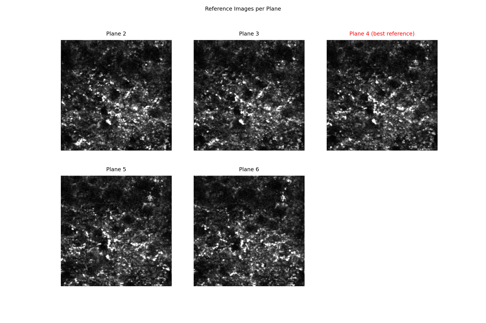
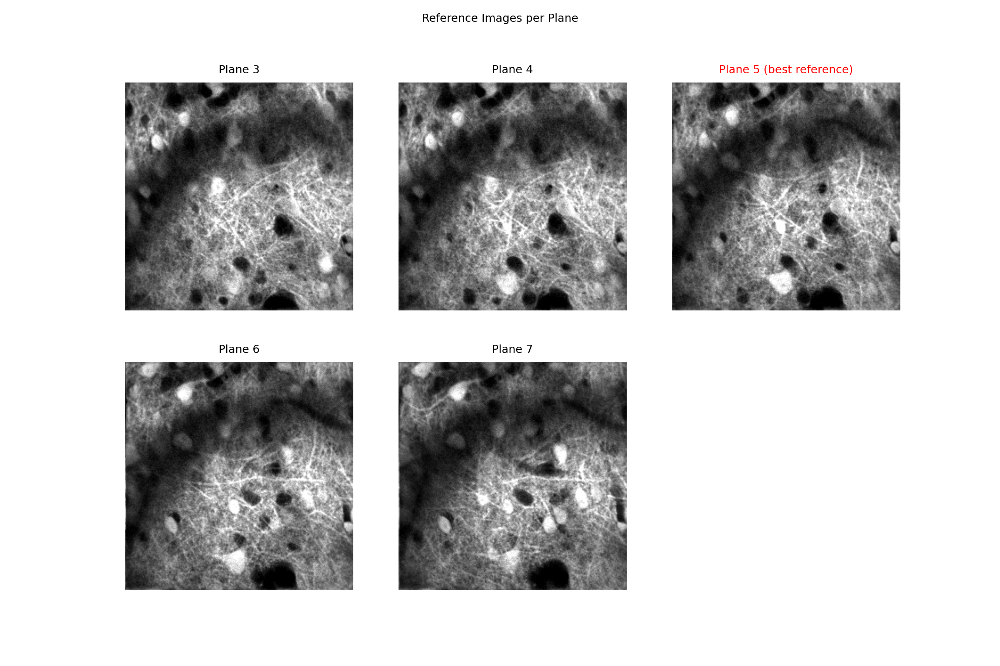
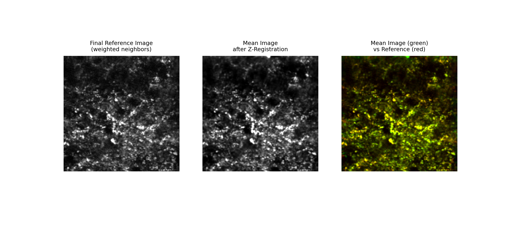
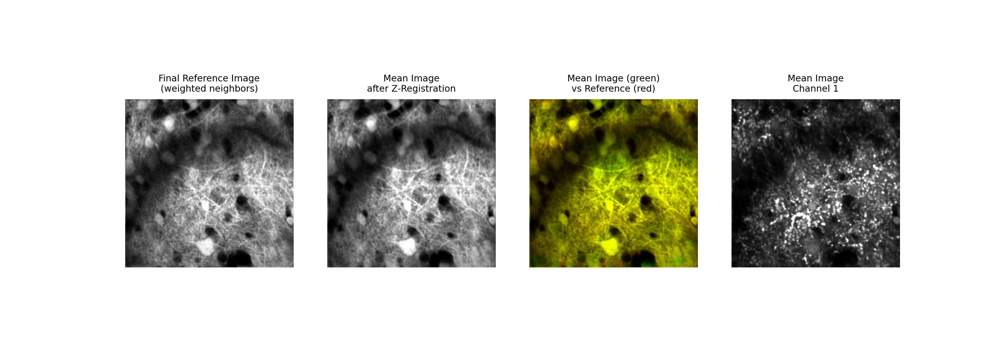
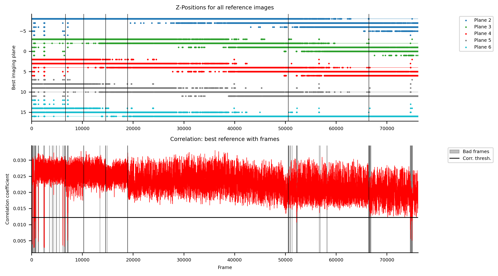
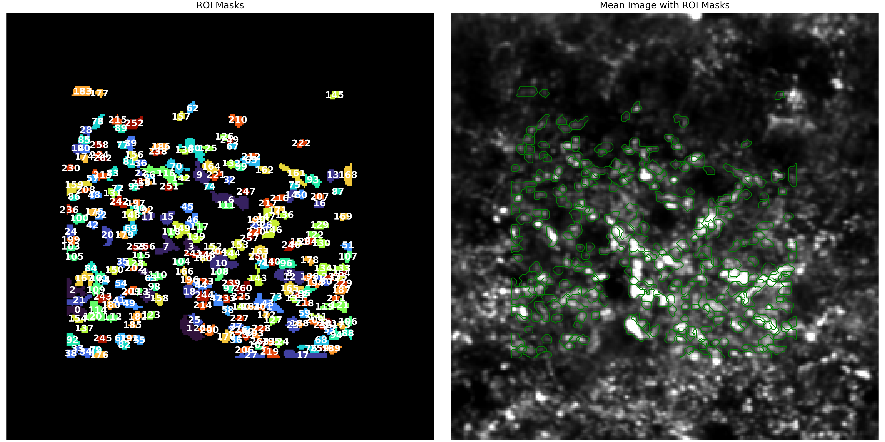
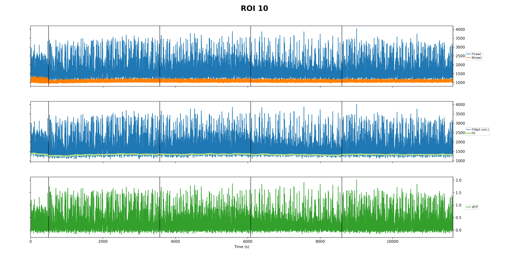
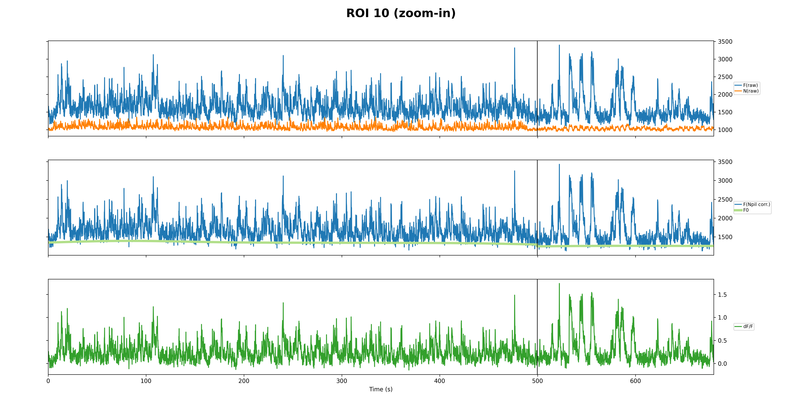

# Reading multi-plane z-registration plots

These examples show the quality-control figures produced by
[Algorithm 2: multi-plane z-registration](z-registration.md). The algorithm combines information
from neighbouring acquired planes into one movie at a selected target depth. Use the figures
to check similarity across planes, alignment of the combined movie, axial position estimates,
ROI selection, and trace processing together.

The example filenames include dataset-specific suffixes. In a normal `zregister` output
directory, the first three plot types are under `suite2p/plots/`. After ROI curation, the optional
`correct-traces` step with `use_zstack: false` writes the ROI overview to
`2P_processed/plane_z/plots/` and individual ROI figures to its `ROIs/` subdirectory. These paths
are relative to the dataset's output directory. ROI plot creation requires `delta_F.plot`; the
optional `_zoomed.png` plots also require `delta_F.plot_zoomed_traces` and a sufficiently long
recording.

## 1. Compare the per-plane references

**`01_reference_images.png`** shows one reference image for each included imaging plane, using
the channel selected for registration. The red title identifies the selected reference plane,
which sets the target depth for the combined movie. Plane labels are zero-based acquisition
indices; check that they match the intended set after flyback planes have been excluded.

In the first example, planes 2-6 are shown and plane 4 is the reference. Registration uses the
functional channel, with GCaMP expressed in axon terminals. In the second example, planes 3-7
are shown and plane 5 is the reference. Registration uses the non-functional channel, with
tdTomato expressed in inhibitory neurons.

Compare corresponding structures across neighbouring planes. They should remain recognisable in similar positions, and
fluorescence sampled by the same ROI mask should be similar across neighbouring depths. As
tissue moves axially, a neighbouring plane may best match the reference at the target depth and
supply frames to the z-registered movie. If the ROI signals differ substantially between planes,
switching the source plane can introduce artificial jumps in the final trace. Similar signals
help preserve continuity across these switches.
Some variation in brightness and detail is expected with depth, but if an ROI samples different
structures or its signal changes substantially between adjacent planes, reconsider whether the
acquisition is sufficiently densely sampled for this method.

## 2. Compare the final reference and registered mean image

**`02_mean_image_zregistration.png`** compares the final reference image (left) with the mean
image of the z-registered movie (centre). The final reference is a weighted combination of the
selected reference plane and its neighbours. Both images use the channel selected for
registration. The overlay shows the reference in red and the registered mean in green; shared
structures appear yellow where they overlap, while separated red and green edges reveal
misalignment.

The two images should closely resemble each other, with corresponding structures in the same
positions and with similar shapes. Compare small features across the field as well as the
overall tissue outline. Brightness and contrast are adjusted for display, so judge alignment
by anatomical correspondence rather than colour balance alone. Substantial spatial disagreement,
duplicated structures, or additional blurring in the mean image indicate that z-registration
has failed to produce a consistent image at the target depth. The position and correlation
plots in section 3 can help identify the underlying reasons.

When registration uses the non-functional channel, as in the second example, the first three panels 
show results from that channel and an additional panel shows the mean image containing the
functional signal. Check that its small structures remain clearly defined. Smeared or duplicated 
features suggest that the registration has not preserved a sharp functional image, even if the 
non-functional channel appears well aligned.

## 3. Read position and correlation over time

**`03_z_positions.png`** shows how the best-matching planes and their correlations change over
time, providing a useful check of registration quality. Both panels share an x-axis labelled
`Frame`: each position corresponds to one imaging cycle across the included imaging planes
and to one combined frame in the z-registered movie. Black vertical lines mark experiment
boundaries.

In the upper panel, each colour represents a reference image, and each dot identifies the
acquired plane whose frame best matched that reference in the corresponding cycle. The coloured
horizontal line marks a match to the reference's own plane; dots away from this line indicate
matches to other planes. The tracks are vertically offset for readability, so their y-axis
positions are not absolute depths or, except for the red track, literal plane numbers. The red
track belongs to the reference at the target depth and shows which plane supplies the
best-matching frame for use in the z-registered movie.

Because brain tissue generally moves consistently across depth, coordinated shifts across the
reference tracks are a reassuring sign that the algorithm is following axial movement. If the
target-depth track repeatedly reaches the first or last included plane, the available depth
range may no longer cover the tissue at the target depth. Matches to neighbouring references
can help estimate how far the target lies beyond the acquired range.

In the example below, the target reference is plane 4, and towards the end of the recording its
best matches often come from plane 6, the deepest included imaging plane. The plane 3 reference (green)
also sometimes matches plane 6, three plane spacings deeper than its own plane. The plane 2
reference (dark blue) frequently matches three plane spacings deeper, but rarely four. Together,
these matches suggest that the axial shift sometimes reaches about three plane spacings. At
those times, matching the plane 4 reference would require a frame from plane 7, which was not
acquired. The closest available source frame, from plane 6, would therefore be about one plane
spacing, or 2 µm in this recording, away from the target depth. This suggests a modest residual
depth mismatch that may still allow robust results if the structures and ROI signals remain
similar over that depth range, as discussed in section 1.

Over shorter intervals, matches usually come from two or three neighbouring planes, indicating
relatively small axial movements on these time scales. At the beginning of the recording,
however, scattered matches span all included planes, suggesting unreliable matching for those
frames. If this instability is frequent, consider excluding the affected period from analysis.
Keep in mind that outlier matches may be rare: the size of the dots can exaggerate their
prevalence, so a few scattered points do not justify discarding an entire period.

The lower panel shows, in red, the correlation between the selected reference at the target
depth and the best-matching frame in each cycle. Drops indicate weaker matches. The black
horizontal line marks the low-correlation threshold: the mean of these best-match correlations
across the recording minus four standard deviations. Frames at or below this threshold are
flagged as bad. Grey shading shows all time points flagged as bad, including those flagged
during individual-plane and final combined-movie registration.
The optional `correct-traces` step sets fluorescence and neuropil values for these frames to
`NaN`, excluding them from subsequent trace processing.

In this example, some of the scattered matches across imaging planes at the beginning of the
recording coincide with sharp drops in correlation. Time points flagged as bad, shown by the
grey shading, are excluded automatically when `correct-traces` is run. This excludes the
flagged time points, not the entire initial period; a scattered match alone does not trigger
exclusion.

The underlying positions, source planes, and correlations are saved in `plane_z/reg_outputs.npy`;
see [Output schemas](outputs.md#algorithm-2-z-registration).

## 4. Check the accepted ROIs

**`ROIs_and_meanImg.png`** shows the accepted ROI masks on the left and their outlines over the
z-registered mean image of the functional channel on the right. Check that the masks cover the
intended structures, especially in crowded regions where a mask may include neighbouring cells
or background. If needed, revise the ROI selection in Suite2p's `plane_z` output before rerunning
trace processing. The labels are zero-based indices within the accepted ROI set and match the
individual trace plot filenames; they are not necessarily the original Suite2p ROI indices.

## 5. Read an individual ROI plot

Each full **`ROIxxxx.png`** has three time-series panels. The traces come from `plane_z`, so
axial registration has already been applied to the movie.

- Raw fluorescence (top): `F(raw)` shows ROI fluorescence and `N(raw)` shows neuropil
  fluorescence extracted from the z-registered movie. Here, "raw" means before neuropil
  correction, not before z-registration. Compare the traces to see whether fluorescence
  changes are prominent in the ROI, the surrounding neuropil, or both.

- Neuropil-corrected fluorescence and baseline (middle): `F(Npil corr.)` shows the
  trace after neuropil correction, alongside its rolling baseline `F0`. The baseline should
  follow slower fluorescence changes rather than individual brief events; its settings are
  `delta_F.F0_percentile` and `delta_F.F0_window`.

- dF/F (bottom): the final trace expresses the neuropil-corrected fluorescence relative to
  `F0`.

The time axis is in seconds. Vertical black lines mark recording segment boundaries. The
optional **`ROIxxxx_zoomed.png`** version shows the first 5,000 frames so individual events and
baseline behaviour are easier to inspect. It shows the same processing result at a shorter
time scale, without recalculating the baseline. The
[trace-production guide](trace-correction.md#settings-and-quality-control-shared-by-both-modes)
describes the settings that control neuropil correction and baseline estimation.

