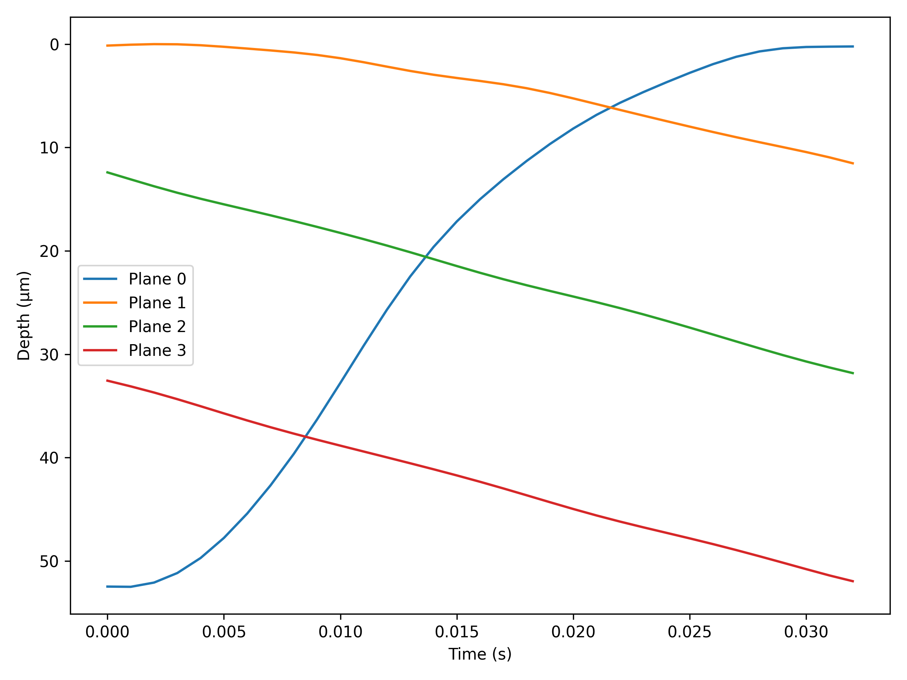
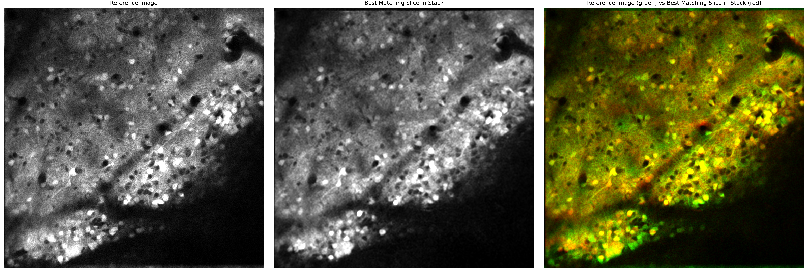
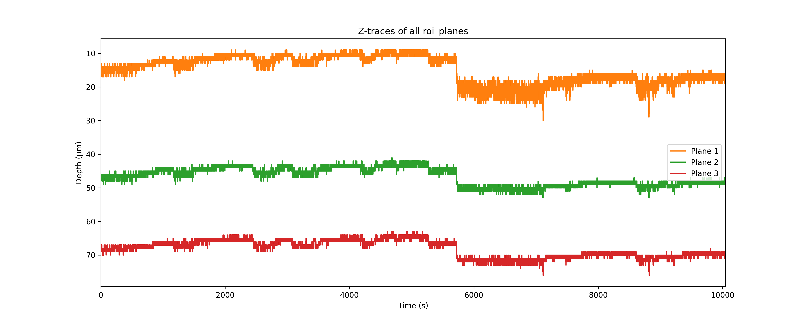
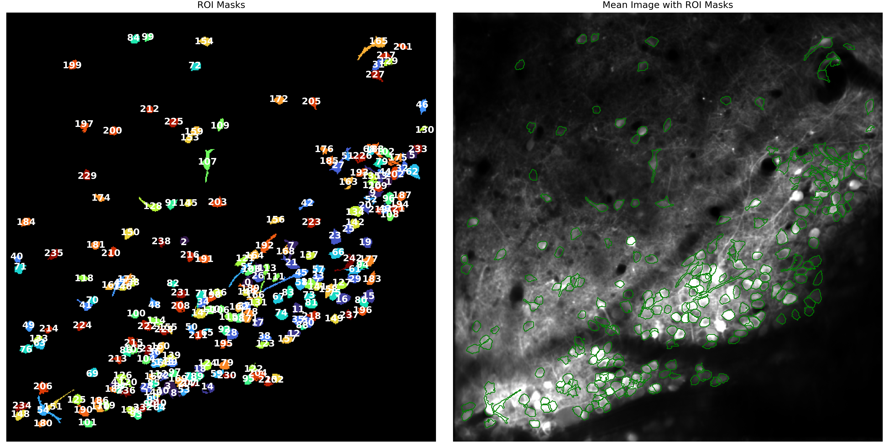
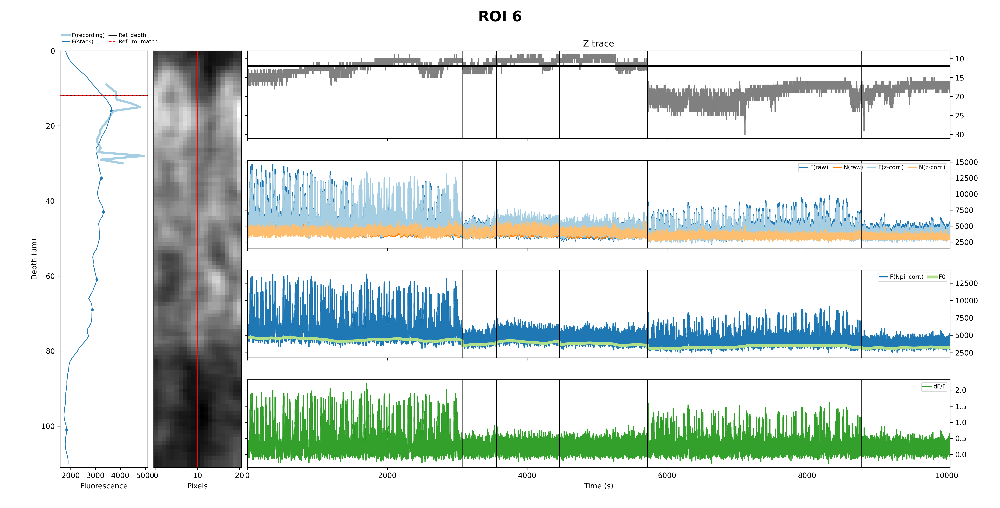
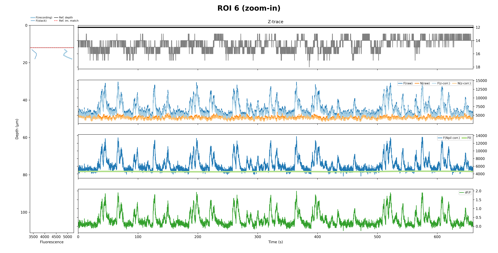
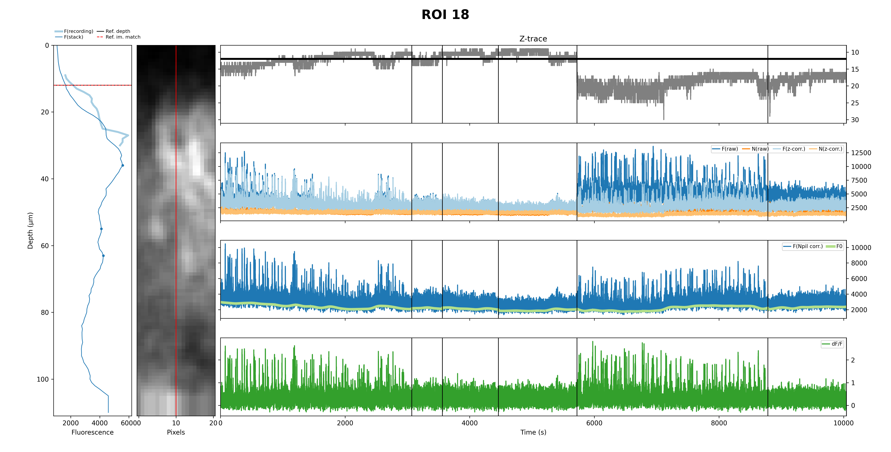
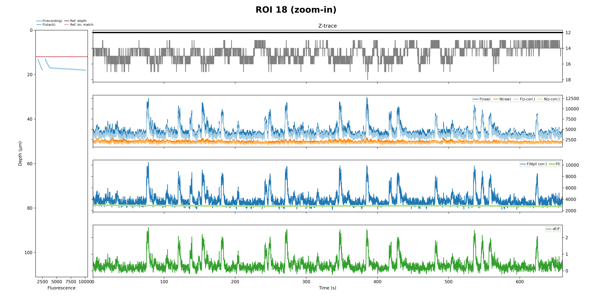

# Reading Z-stack correction plots

These examples show the quality-control figures produced around [Algorithm 1: z-stack-based trace
correction](z-stack-correction.md). They come from one recording with four acquired planes; the ROI
examples are from plane 1. Use the figures to check the acquisition geometry, stack alignment, axial
position estimates, ROI selection, and trace processing together. A plausible-looking final dF/F
trace alone does not establish that the axial correction worked.

The figures below have dataset-specific suffixes. In a normal `correct-traces` output directory,
`piezo_per_plane.png` and `zTraces_allPlanes.png` are under `2P_processed/plots/`. The other figures
are under `2P_processed/planeN/plots/`, with individual ROI figures in its `ROIs/` subdirectory.
Plot creation depends on `daq.plot_piezo`, `z_correction.plot`, and `delta_F.plot`; the optional
`_zoomed.png` plots also require `delta_F.plot_zoomed_traces` and a sufficiently long recording.

## 1. Check the scan geometry

**`piezo_per_plane.png`** shows the mean within-frame piezo trajectory for each acquired plane. The
horizontal axis is time within one frame, and the inverted vertical axis shows relative depth in
micrometres, with the top-most position set to zero. In this recording, planes 1-3 move
deeper during their frames, while plane 0 moves in the opposite direction, consistent with flyback.
We usually exclude the flyback plane because it can contain ROIs also seen in the other planes,
although z-stack correction can process it. To exclude a plane, enter its zero-based index in the
[`Ignore_planes` column](dataset-csv.md#algorithm-1-datasets_zstackcsv) of `datasets_zstack.csv`.

Compare the curve shapes, plane order, and spacing with your imaging settings. An incorrect plane
count, DAQ synchronization, or voltage-to-distance calibration can affect stack reslicing and ROI
depths. If the plot differs from your expectations, check:

- that the piezo moved as expected;
- that the DAQ recorded the measured piezo position rather than the command signal (which may look
  sawtooth-shaped);
- that `daq.piezo_channel_name` selects the piezo signal in
  [`get_piezo_data`](../src/suite2p_in_depth/extract_data.py#L166), and `daq.clock_channel_name`
  selects the frame clock in [`get_frame_times`](../src/suite2p_in_depth/extract_data.py#L210);
- that [`daq.piezo_volt_per_micron`](../src/suite2p_in_depth/config/zstack.yaml#L30) matches your piezo calibration.

To inspect piezo motion before running the full pipeline, use the
[`suite2p-in-depth plot-piezo` CLI subcommand](helper-utilities.md#plot-piezo).

## 2. Check movie-to-stack alignment

**`Reference_and_matchingSlice.png`** compares the reference image from the functional recording
(left) with the registered and resliced stack slice selected as its best match (centre). Both
images use the channel selected for alignment, which can differ from the functional channel. The
third panel shows the movie reference in green and the stack slice in red. Shared landmarks appear
yellow where they overlap; separated red and green edges reveal differences in feature position.
Inspect small features across the field of view as well as the overall tissue outline.

In this example, alignment used the non-functional channel, with tdTomato expressed by inhibitory
neurons. The main tissue boundary and many bright structures occupy similar positions in the two
grayscale panels. Some neurons scattered across the field are brighter in one image than in the
other. These intensity differences are generally less concerning when the structures themselves
coincide. The two images are scaled independently for display, so an aligned feature need not
appear equally bright in both panels or perfectly yellow in the overlay. Judge alignment primarily
by the positions and shapes of corresponding structures.

A more concerning pattern is good alignment in one region but displaced or distorted structures
elsewhere. This can indicate residual lateral misalignment or incorrect stack reslicing, for
example if the piezo signal does not accurately describe the depth at which each image row was
acquired. It can also reflect tissue deformation between the recording and stack acquisition, or
poor stack quality caused by substantial axial movement during acquisition. The overlay alone
cannot distinguish these causes. Recheck the scan geometry described in section 1 and inspect the
stack before deciding whether registration settings need adjustment. If the stack does not
represent the tissue geometry in the recording, parameter changes may not produce a reliable match.

For local lateral misalignment between the movie reference and the stack, consider adjusting
[`suite2p_stack_to_ref.block_size`](../src/suite2p_in_depth/config/zstack.yaml#L57) in your
`zstack.yaml`. This sets the block dimensions in pixels (`[y, x]`) for nonrigid registration to
the movie reference. Assess any change across the whole field: improving one region is useful
only if correspondence elsewhere remains convincing.

Also open the registered and resliced stack in a viewer such as ImageJ and scroll through depth.
It is saved as `2P_processed/planeN/stack_planeN_chanC.tif` beneath the dataset's output directory,
where `N` is the zero-based plane index and `C` is the alignment channel number (1 or 2). When
alignment uses a different channel from the functional signal, a second TIFF contains the
functional channel transformed with the same shifts. Structures naturally change shape and
brightness with depth; look for abrupt lateral jumps or discontinuities between neighbouring
slices. If these suggest poor alignment across stack slices, review the
[`suite2p_stack_across`](../src/suite2p_in_depth/config/zstack.yaml#L48) settings in `zstack.yaml`,
which control that registration step.

When testing revised settings, regenerate the cached stack and correlation outputs before
comparing results. An ordinary rerun reuses existing stack TIFFs, best-slice indices, and
correlations, so changing the configuration alone may leave the alignment result unchanged.
For each affected plane, move `stack_planeN_chanC.tif` (for all saved channels),
`bestSlice_planeN.npy`, and `zcorr_planeN.npy` out of `2P_processed/planeN/` into a separate backup
folder, or delete these cached files if you no longer need them. Then rerun `correct-traces` with
the revised `zstack.yaml` and `--overwrite` when replacing a completed run; the missing files will
be regenerated from the original input z-stack and registered movie. Moving the files preserves
the previous alignment for comparison. Keep the original input z-stack in place.

## 3. Check the estimated axial trajectory

**`zTraces_allPlanes.png`** shows the estimated axial position of each processed imaging plane
over the recording. The horizontal axis is time in seconds; the vertical axis is depth in
micrometres. Each trace follows the stack slice that best matches the registered movie frames;
it is an estimate from image matching, not a direct measurement of tissue movement.

In this recording, planes 1-3 were analysed and the flyback plane, plane 0, was excluded. Several
changes occur at similar times across the three traces. Because axial brain movement is generally
consistent across depth, agreement in the timing and direction of shifts is a reassuring sign
that the algorithm has recovered the expected motion. A shift confined to one plane, or markedly
different displacement estimates, warrants a closer look at that plane's movie-to-stack alignment
and matching results.

The larger shared shift around 5,700 seconds deserves particular attention in the individual ROI
plots. A substantial change in depth can move an ROI into a brighter or dimmer part of its stack
fluorescence profile, making the correction more dependent on accurate depth estimates and a
representative profile. Use the ROI profiles, traces, and alignment
checks together to assess the result.

Gaps appear when the best match is at the upper or lower boundary of the evaluated stack range.
These estimates are set to `NaN` because the true depth may lie beyond that range; repeated
boundary matches produce long gaps. Poor or ambiguous image matching can also favour a boundary
slice.

[`2pPlanes.zCorrelations.npy`](outputs.md#algorithm-1-z-stack-based-trace-correction) stores the
correlations between each movie frame and each evaluated stack slice, separately for each plane.
Plotting these values against slice depth reveals a clear peak, or broad or competing peaks
that make depth uncertain. Uncertainty is less concerning if alignment
is good and the ROI fluorescence profiles vary little across the plausible depths. If alignment
is poor, revisit section 2; if the stack still cannot be aligned reliably, avoid using it for
z-stack correction. Also avoid correction for ROIs whose profiles vary strongly across depths
that the algorithm cannot distinguish.

The plotted depth is relative to the first z-stack slice, with zero at that slice. For a sloped
acquisition, the plotted depth of each frame refers to the depth at the middle image row. The
absolute depths in this plot differ from those in the scan geometry plot in section 1, whose
zero is the top-most piezo position. Changing the origin shifts all depths equally and does not change
the separation between planes. When comparing plane separations between the two plots, use the
piezo depths at the middle scan rows rather than assuming equally spaced planes or comparing
their start or end positions. Check `z_correction.spacing` and, when piezo data are used,
`daq.piezo_volt_per_micron` in `zstack.yaml` if the depth scale or scan geometry appears incorrect.

The saved `2pPlanes.zTraces.npy` values remain stack-slice indices; only plotting multiplies them
by `z_correction.spacing` to display micrometres.

## 4. Check the accepted ROIs

**`ROIs_and_meanImg.png`** shows the accepted ROI masks on the left and their outlines over the
registered mean image of the functional channel on the right. Check that the masks cover the
intended structures, especially in crowded regions where a mask may include neighbouring cells
or background. If needed, revise the ROI selection in Suite2p before rerunning trace correction.
The labels are zero-based indices within the accepted ROI set and match the individual trace
plot filenames; they are not necessarily the original Suite2p ROI indices. The examples below
are ROIs 6 and 18 from this plane.

## 5. Read an individual ROI plot

Each full **`ROIxxxx.png`** has two panels on the left and four time-series panels on the right:

- Axial fluorescence profile (far left): `F(stack)`, in dark blue, shows fluorescence extracted
  from the ROI mask at each stack depth. Dots mark detected local peaks, which may correspond
  to different neurons along the same axial column. `F(recording)`, in light blue, shows the
  fluorescence percentile configured by `delta_F.F0_percentile`, calculated from frames matched
  to each depth. Similar profile shapes over well-sampled depths are reassuring. Sparse sampling
  and changes in functional activity between recording segments can cause deviations.

- Stack cross-section (second from left): a narrow section through the ROI centre shows how
  structures change with depth. The red vertical line marks the centre of the ROI mask.

- Z trace (top right): the grey trace shows the plane's estimated depth in micrometers. The black line marks
  the reference depth to which fluorescence is corrected. Internally, the reference slice is
  selected from the median finite slice index over the first recording segment when
  `z_correction.reference: first`, or over the full recording when set to `all`. 
  The same reference appears as a black line in the axial profile.
  Its dashed red line marks the depth of the slice matched to the movie reference image, which
  can differ from the correction reference depth.

- Raw and z-corrected fluorescence (second from top): compare `F(raw)` with `F(z-corr.)` and
  `N(raw)` with `N(z-corr.)`, where `N` denotes neuropil. Correction is based on the ratio of
  stack fluorescence at the reference depth to that at the estimated depth. A brighter stack
  profile at the current depth leads to downscaling; a dimmer profile leads to upscaling. The
  depth-dependent factor is smoothed over neighbouring frames before application, and the same
  ROI-derived factor is used for neuropil.

- Neuropil-corrected fluorescence and baseline (third from top): `F(Npil corr.)` shows the
  trace after neuropil correction, alongside its rolling baseline `F0`. The baseline should
  follow slower fluorescence changes rather than individual brief events; its settings are
  `delta_F.F0_percentile` and `delta_F.F0_window`.

- dF/F (bottom): the final trace expresses the neuropil-corrected fluorescence relative to
  `F0`.

The profile, cross-section, and z-trace depth axes use micrometres, with the same stack origin
as in section 3. Vertical black lines mark recording segment boundaries.

The **`ROIxxxx_zoomed.png`** version shows the first 5,000 frames and omits the stack cross-section.
Its axial profile includes only depths visited during that interval, and `F(recording)` is
calculated from those frames.

### ROI 6

The recording fluorescence broadly follows the stack profile across the visited depths. The
isolated deviations around 15 µm and deeper than 25 µm should be interpreted in light of how few
frames contribute at those depths, rather than taken alone as evidence of failed alignment.

In the second half of the recording, the plane is deeper than the reference and the stack
profile is brighter, so the corrected ROI trace is scaled down relative to the raw trace. This
illustrates why scaling depends on the profile shape, not simply on whether the plane moved
deeper or shallower. The zoomed view shows individual calcium events in more detail.

### ROI 18

Compared with ROI 6, ROI 18 has a steeper stack profile over the visited depths, so correction
reduces the raw fluorescence more strongly in the second half of the recording. This stronger
scaling makes accurate depth estimates particularly important.

At the deepest estimated positions, it is uncertain whether the recorded fluorescence still
comes from the same neuron. Fortunately, very few frames were recorded at depths beyond 25 µm,
so this concern affects only a small part of the recording.

